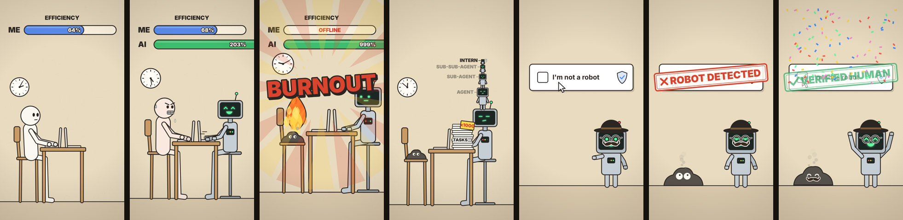

# AI vs Human — animated shorts made 100% with code



The animated YouTube Shorts from [@code-pulse-ai](https://www.youtube.com/@code-pulse-ai), with every frame drawn by plain JavaScript on an HTML `<canvas>`.
There are no video files, no image assets, no drawing tools and no AI image or video generators. The sound effects and music are synthesized with NumPy, so there are no audio files either.

| Episode | Scene file |
|---|---|
| 1. **AI AGENTS AT WORK 💀** — the human burns out, the AI delegates… recursively | `ai_agents.js` |
| 2. **I'M NOT A ROBOT 💀** — the robot vs. the CAPTCHA (and the little ash pile from ep. 1) | `captcha.js` |

## Watch it running (no install)

Download or clone the repo and open **`index.html`** in your browser. The animation is drawn live, frame by frame. Pause it, scrub the timeline or step one frame at a time (← / →), and you'll see it's just code.

## Render the MP4 yourself

Requirements: Python 3.9+, [ffmpeg](https://ffmpeg.org/download.html) on your PATH.

```bash
pip install -r requirements.txt
python -m playwright install chromium

python render.py                     # episode 1  -> ai_agents.mp4
python render.py --scene captcha     # episode 2  -> captcha.mp4
python render.py --lang pt           # Portuguese on-screen text -> ai_agents_pt.mp4
python render.py --scene captcha --frames 0 165 300   # just a few PNG frames, for a quick look
```

Output: 1080×1920, 30 fps, H.264 + AAC, ready for Shorts. A full render takes a minute or two.

## How it works

```
scene .js  ──  draw(ctx, t)    → paints the frame at time t (seconds)
           └─  audioEvents()   → list of sound events from the same timeline
                                          │
render.py  ──  headless Chromium grabs every frame ──┐
sounds.py  ──  synthesizes the events into a .wav ───┴─→ ffmpeg → MP4
```

- **Everything is a function of time.** Each scene file starts with a `TL` (timeline) object: `TL.ignite = 7.4` means the human catches fire at 7.4 s. Change one number and the drawing *and* the sound move together, so they never drift out of sync.
- **No keyframes and no state.** `draw(ctx, t)` can render any instant directly, which is why the browser player can scrub freely.
- **Characters are built from primitives**: rounded rectangles, circles and outlined "limbs" (a thick dark stroke under a lighter one). Easing helpers (`seg`, `bump`, `easeOutBack`…) do the motion.
- **Sounds are math.** In `sounds.py`, a click is filtered noise with a fast decay, the "ding" is three sine harmonics, the beat is a pitch-dropping sine kick plus a noise hi-hat, and the "awkward silence" is synthetic crickets.

## Files

| File | What it does |
|---|---|
| `ai_agents.js`, `captcha.js` | The episodes: timeline, colors, texts (EN/PT), drawing and sound events |
| `index.html` | Live browser player (play / pause / scrub / frame-step, switch episode and language) |
| `render.html` | Minimal page that `render.py` loads in headless Chromium |
| `render.py` | Frame capture + audio + ffmpeg mux |
| `sounds.py` | Sound effect and music synthesizer (NumPy only) |

## Make your own episode

1. Copy `captcha.js` to `my_scene.js`.
2. Edit `TL` (the beats), `TXT` (the on-screen words) and the `draw*` functions.
3. Preview it with `index.html?scene=my_scene`, or render it with `python render.py --scene my_scene`.

---

Written with the help of AI. Every frame and every sound comes from the code in this repo.
